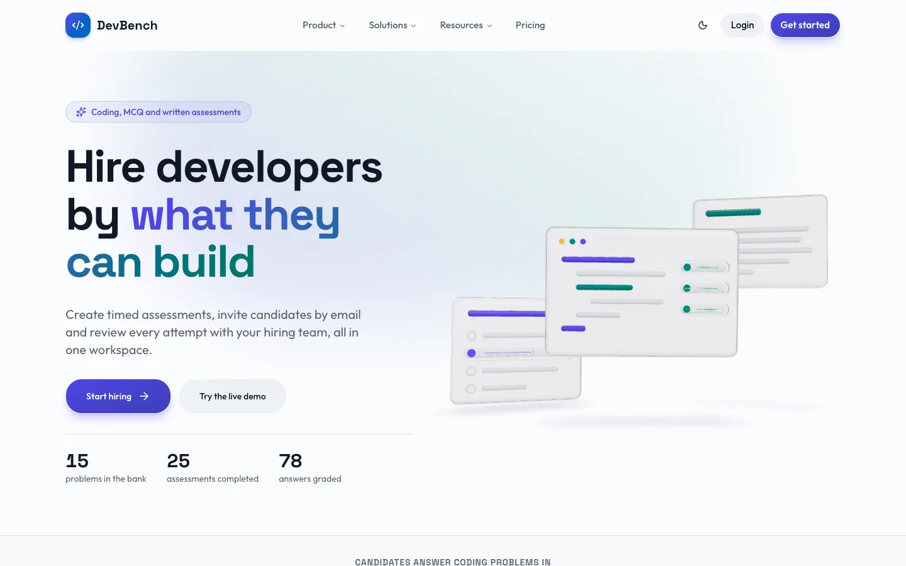
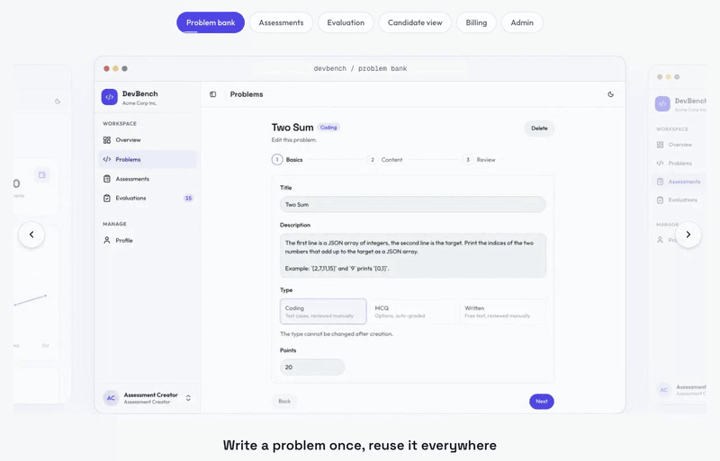
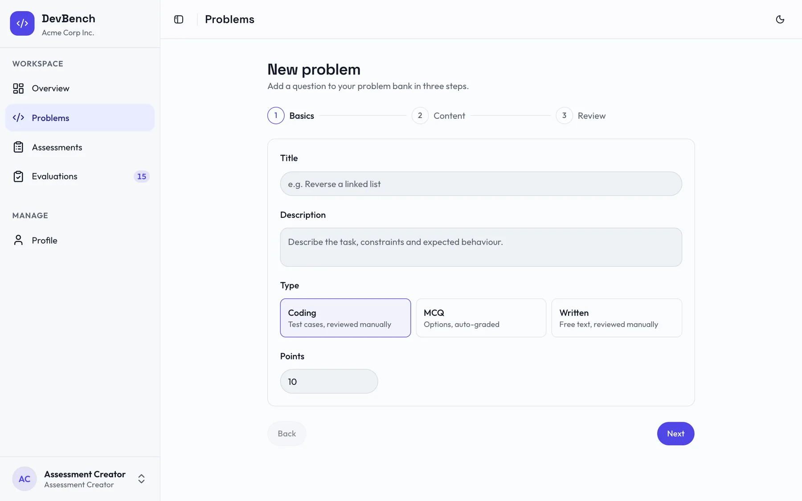
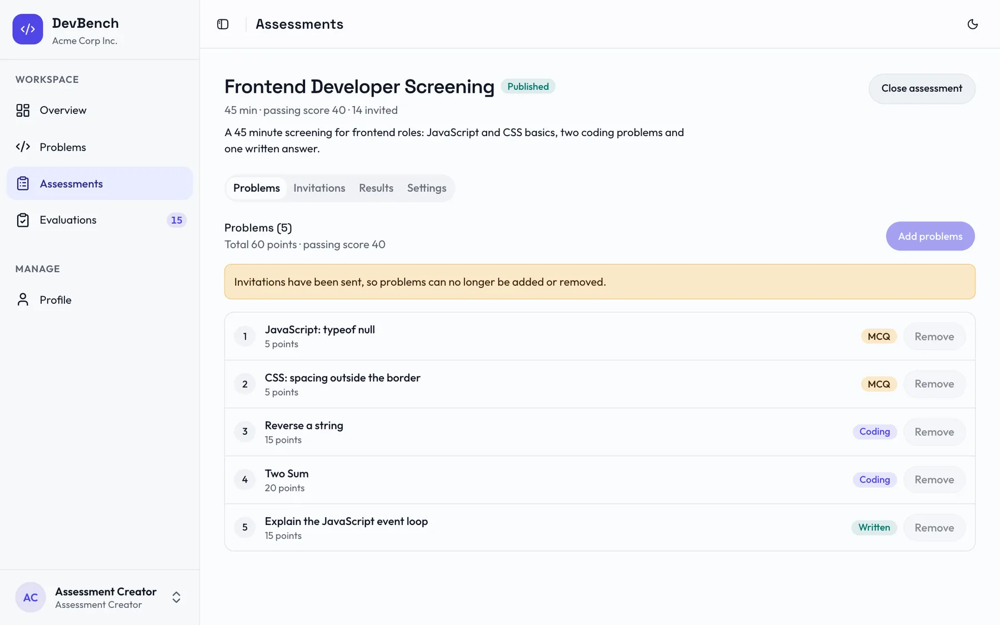
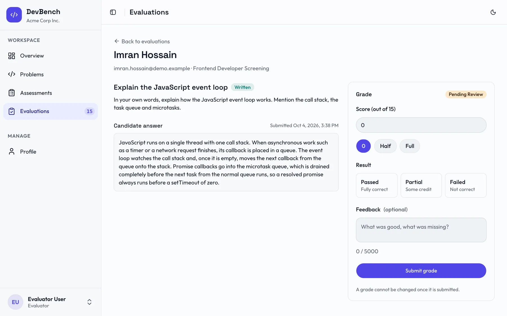
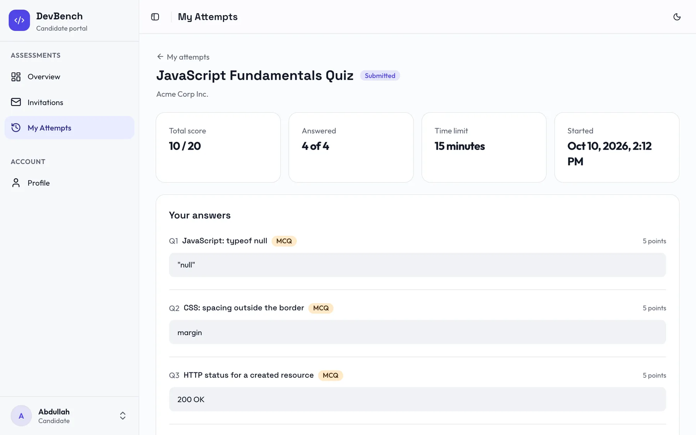
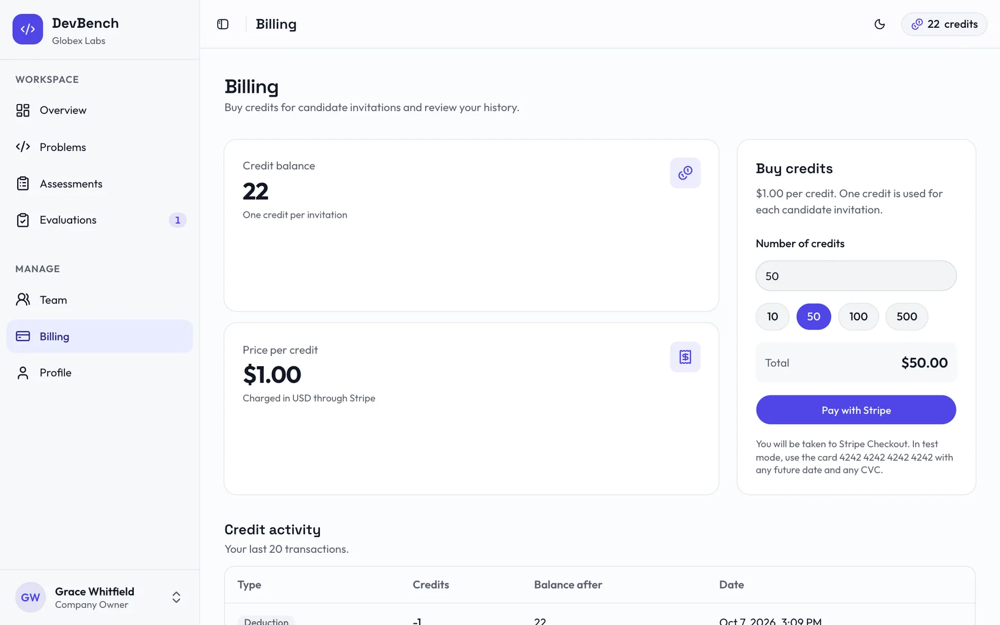
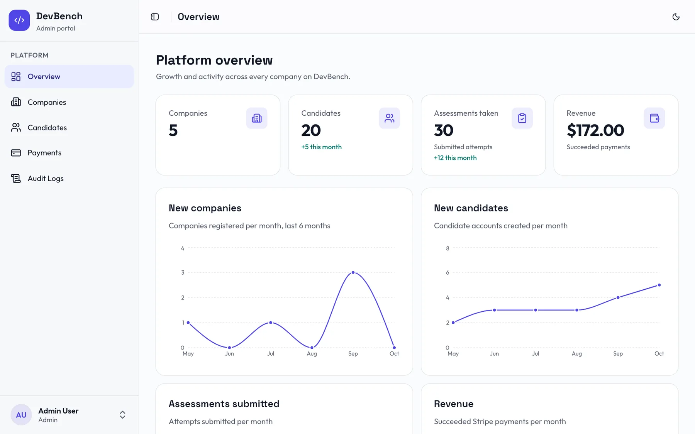
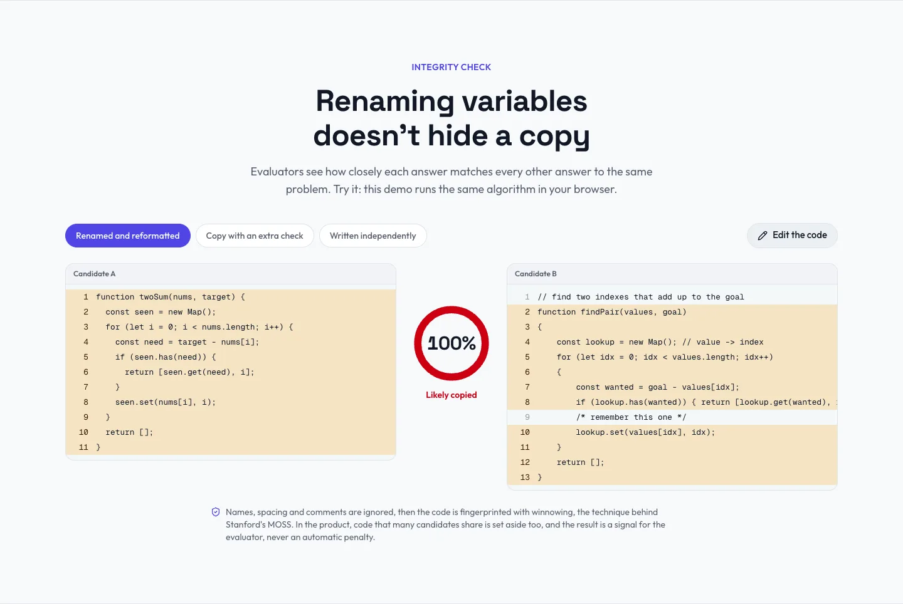
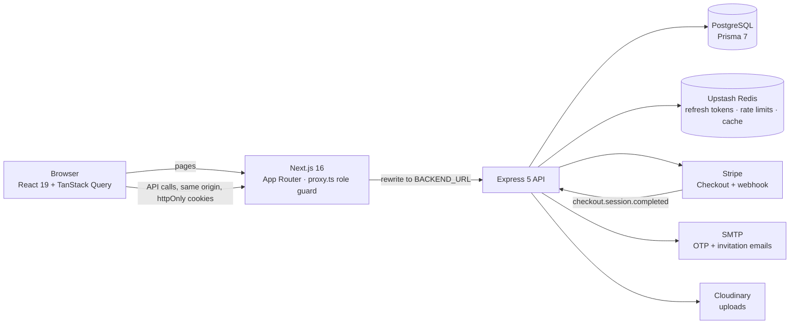

<div align="center">

# DevBench

**Hire developers by what they can build.**

Timed coding, MCQ and written assessments, an integrity check that sees through renamed variables, and a review workflow for the whole hiring team.

[](https://devbench-frontend-ten.vercel.app/)
[](https://devbench-backend.vercel.app/)
[](https://github.com/abdullahmamun1/devbench-backend-api)


<picture>
  <source media="(prefers-color-scheme: dark)" srcset="docs/readme/home-dark.webp">
  
</picture>

</div>

This is the web app. The REST API lives in [devbench-backend-api](https://github.com/abdullahmamun1/devbench-backend-api).

## Table of contents

- [Why DevBench](#why-devbench)
- [Product tour](#product-tour)
- [Features](#features)
- [Smart features (no AI, no API keys)](#smart-features-no-ai-no-api-keys)
- [Architecture](#architecture)
- [Tech stack](#tech-stack)
- [Guided installation](#guided-installation)
- [Troubleshooting](#troubleshooting)
- [Demo accounts](#demo-accounts)
- [Scripts](#scripts)
- [Project structure](#project-structure)
- [Deployment](#deployment)
- [Roadmap and known gaps](#roadmap-and-known-gaps)
- [Author](#author)

## Why DevBench

| The problem hiring teams face | How DevBench solves it |
|---|---|
| A CV doesn't show whether someone can code | Timed assessments mixing coding problems with test cases, auto-graded MCQs and written answers |
| Take-home tests have no time limit | The deadline is set by the server when the attempt starts. Answers autosave, and the attempt is submitted automatically when time runs out |
| Reviewing answers eats engineers' time | MCQs are graded instantly. Only coding and written answers reach the review queue, oldest first |
| Copied answers slip through | Similarity detection ignores renamed variables, spacing and comments, and flags tab switches and large pastes |
| Some questions don't separate strong from weak candidates | Question analysis shows the pass rate and discrimination of every question |
| It's hard to compare a pile of results | Shared ranks, percentiles, a score histogram and a per-type breakdown for each candidate |
| Building a balanced test by hand is guesswork | Smart pick fills the timer from your bank, using how long candidates really took and how they scored |
| Nobody knows who changed what | Every sensitive action is written to an audit log |
| Paying for seats you don't use | Pay per invitation: one credit sends one invitation, bought through Stripe |

## Product tour

<div align="center">
  
</div>

Every screenshot below comes from the seeded demo workspace. GitHub shows the dark version when your theme is dark.

| Problem bank | Assessment |
|---|---|
| <picture><source media="(prefers-color-scheme: dark)" srcset="public/images/tour/problem-wizard-dark.webp"></picture> | <picture><source media="(prefers-color-scheme: dark)" srcset="public/images/tour/assessment-detail-dark.webp"></picture> |
| **Evaluation with integrity panel** | **Candidate results** |
| <picture><source media="(prefers-color-scheme: dark)" srcset="public/images/tour/evaluation-review-dark.webp"></picture> | <picture><source media="(prefers-color-scheme: dark)" srcset="public/images/tour/candidate-results-dark.webp"></picture> |
| **Billing** | **Admin overview** |
| <picture><source media="(prefers-color-scheme: dark)" srcset="public/images/tour/billing-dark.webp"></picture> | <picture><source media="(prefers-color-scheme: dark)" srcset="public/images/tour/admin-overview-dark.webp"></picture> |

## Features

**Everyone**
- Marketing site: home with a 3D hero and a live integrity demo, features, pricing with a credit calculator, about, FAQ and contact form.
- Register with email OTP verification (resend with a cooldown), log in, Google Sign-In, forgot and reset password.
- One-click demo login for every role.
- Light and dark mode with checked contrast, responsive down to 375px, keyboard and screen reader friendly, and reduced motion respected.

**Company owner, assessment creator and evaluator**
- Overview with stats, quick actions for each role, and charts of real activity: invitations and submissions per month, attempt outcomes and average score by problem type.
- Problem bank with a three-step wizard: CODING with test cases (some hidden), MCQ with options, WRITTEN. The draft survives a page refresh.
- Assessments: create, edit, publish and close, and attach many problems at once, or let **Smart pick** fill the timer for you.
- Invite candidates by email, resend or revoke (a revoke refunds the credit).
- Results tab: ranks, percentiles, a score histogram and question analysis.
- Evaluation queue: score coding and written answers with feedback. The integrity panel sits beside each answer.
- Team management with role invitations (owner).
- Billing: buy credits through Stripe Checkout, payment history and a credit ledger.

**Candidate**
- Overview with invitations, live attempts, a score chart and an outcome breakdown.
- Accept an invitation by link, then take a timed exam with a Monaco code editor, autosave and a countdown.
- Results with scores and evaluator feedback.

**Admin**
- Platform stats, monthly trend charts and an editable profile.
- Companies, candidates, payments and audit logs, with search, filters and pagination.
- Suspend, reactivate or delete accounts, and adjust company credits with a reason.

## Smart features (no AI, no API keys)

DevBench uses no LLM and needs no API key. These features are plain algorithms and statistics that run on DevBench's own servers, and in your browser for the demo.

<picture>
  <source media="(prefers-color-scheme: dark)" srcset="docs/readme/integrity-dark.webp">
  
</picture>

### 1. Integrity check
- **Similarity detection** uses winnowing, the fingerprinting technique behind Stanford's MOSS:
  1. Normalise the code. Comments and whitespace are dropped, and identifiers and literals become placeholders, so renaming and reformatting change nothing.
  2. Hash every run of 5 tokens and keep the smallest hash in each window of 4 (written answers use word tokens).
  3. Score a pair as shared fingerprints divided by the smaller set, and map the matches back to line ranges for a side-by-side view.
  4. Fingerprints that most candidates share (the "textbook" answer) are set aside, so honest candidates aren't flagged.
- **Thresholds:** 70% and above is "Likely copied", 40–70% is "Worth a look", and anything lower isn't flagged.
- **Exam signals:** the exam runner logs tab switches, time away, pastes (with size) and question views, in small batches.
- **A signal, never a penalty:** evaluators see the evidence and decide.

The home page demo runs the same code (`src/lib/similarity.ts`, kept in sync with the API) in your browser.

### 2. Candidate insights and ranking
- For evaluators: rank and percentile with shared ranks for ties, plus a breakdown by problem type and time per question.
- A summary in plain language built from fixed templates, for example "Strong on coding (90%), weaker on written answers (40%)".

### 3. Smart pick (assessment builder)
- Set a duration, a type mix (presets such as Balanced or Quick screen, or your own percentages) and a difficulty. Smart pick proposes problems from your bank that fill the time.
- **Time per problem:** the median time real candidates spent on it once 3 have answered, otherwise an estimate from its type and points. Each pick is labelled "measured" or "estimated".
- **Difficulty:** the average graded score once 5 answers exist (easy, medium or hard).
- **Planning:** 10% of the time is kept free for reading and checking. Each type fills its share with a small knapsack over whole minutes, and unused minutes roll over to the next type.
- Every pick explains itself, a bar shows where the time goes, and you untick anything before adding.

### 4. Question analysis
- Classic item analysis from test theory: the pass rate (difficulty) of each question, and its discrimination (how much better the top 27% did than the bottom 27%).
- Questions that don't separate strong from weak candidates are flagged for review.
- It's shown only once an assessment has 5 graded attempts, so small samples don't mislead.

## Architecture



- **One origin:** the browser only calls `/api/v1/*` on the frontend, which Next.js rewrites to the API (`next.config.ts`). Auth cookies stay first party, and the browser never makes a cross-origin request.
- **Refresh once:** `src/lib/apiClient.ts` (ofetch) retries a request once after a 401 by refreshing the token, and concurrent requests share one refresh.
- **Route guard:** `src/proxy.ts` redirects by role before a page renders, and `RoleGuard` checks again on the client.
- **Data flow per domain:** `types/x.type.ts` → `api/x.api.ts` → `hooks/x.hook.ts` (TanStack Query) → components.
- **URL state:** search, filters, tabs and pages live in the query string, so refresh, back and shared links all work.
- **Fast failure:** 4xx responses are not retried, so a missing item shows its error at once, and error messages are always plain sentences.

## Tech stack

| Area | Choice |
|---|---|
| Framework | Next.js 16 (App Router), React 19 with the React Compiler, TypeScript |
| Styling | Tailwind CSS v4 (OKLCH tokens), shadcn/ui on Base UI, next-themes |
| Motion and 3D | Motion, Embla Carousel, three.js with React Three Fiber (lazy-loaded, paused off-screen) |
| Server state | TanStack Query |
| Client state | Zustand (problem wizard and its saved draft) |
| Forms | TanStack Form with Zod |
| HTTP | ofetch with a single refresh-token retry |
| Editor and charts | Monaco Editor and Recharts, both loaded on demand |
| Tooling | Bun, Biome |

## Guided installation

You run two apps side by side: the API on port 5000 and this frontend on port 3000. Every step ends with a ✅ check.

### 1. Prerequisites

```bash
node -v      # v20 or newer
bun -v       # 1.x  (install: curl -fsSL https://bun.sh/install | bash)
git --version
```

✅ All three print a version.

### 2. Clone both repos side by side

```bash
mkdir devbench && cd devbench
git clone https://github.com/abdullahmamun1/devbench-backend-api.git
git clone https://github.com/abdullahmamun1/devbench-frontend.git
```

✅ `ls` shows `devbench-backend-api` and `devbench-frontend`.

### 3. Start the API

Follow the backend's [guided installation](https://github.com/abdullahmamun1/devbench-backend-api#guided-installation). It walks through the database, Redis, Stripe, Google, email and Cloudinary setup, then the demo seed.

✅ `curl http://localhost:5000` prints `DevBench API is running`.

### 4. Configure the frontend

```bash
cd devbench-frontend
bun install
cp .env.example .env.local
```

| Variable | Value for local development |
|---|---|
| `NEXT_PUBLIC_API_BASE_URL` | `/api/v1`. Keep it: requests go through the rewrite |
| `BACKEND_URL` | `http://localhost:5000` (the API origin, no `/api/v1`) |
| `NEXT_PUBLIC_SITE_URL` | `http://localhost:3000` |
| `NEXT_PUBLIC_GOOGLE_CLIENT_ID` | The same client ID the API uses. Leave it empty to hide Google Sign-In |
| `NEXT_PUBLIC_CREDIT_PRICE_CENTS` | `100`. It must equal the API's `CREDIT_PRICE_IN_CENTS` |
| `NEXT_PUBLIC_CONTACT_EMAIL` | Any address to show on the contact page and in the footer |
| `NEXT_PUBLIC_LINKEDIN_URL`, `NEXT_PUBLIC_X_URL` | Optional footer social links. Leave them empty to hide the icons |

✅ `.env.local` exists and `BACKEND_URL` points at the running API.

### 5. Run it

```bash
bun dev
```

✅ Open http://localhost:3000, click **Log in**, then **Hiring? Open the Acme Corp workspace**. You land on the company dashboard with demo data.

### 6. Optional: payments

With `stripe listen` running for the API (see the backend README), buy credits on **Billing** with the test card `4242 4242 4242 4242`, any future date and any CVC.

✅ The credit balance in the header goes up after checkout.

## Troubleshooting

| Symptom | Fix |
|---|---|
| "We couldn't reach DevBench" on every page | The API isn't running, or `BACKEND_URL` is wrong. Rewrites are read at startup, so restart `bun dev` after changing it |
| Port 5000 is already in use (macOS) | AirPlay Receiver uses it. Set `PORT=3114` in the API's `.env` and `BACKEND_URL=http://localhost:3114` here, then restart both |
| Logged out right after logging in (production) | The API needs `NODE_ENV=production` (so cookies are `Secure; SameSite=None`), and its `APP_URL` must be this site's exact origin |
| Google button is missing | `NEXT_PUBLIC_GOOGLE_CLIENT_ID` is empty, or this origin isn't listed under the client's authorised JavaScript origins |
| Credits don't arrive after checkout | Only the Stripe webhook adds credits. Run `stripe listen` and copy its `whsec_…` into the API's `STRIPE_WEBHOOK_SECRET` |
| Price on the pricing page differs from Checkout | `NEXT_PUBLIC_CREDIT_PRICE_CENTS` and the API's `CREDIT_PRICE_IN_CENTS` differ |
| Hydration warning after editing a component | Don't read `window`, the theme or reduced motion during the first render. Read them in an effect |

## Demo accounts

The login page has one-click buttons for the first five. The large button opens the company owner's workspace.

| Role | Email | Password |
|---|---|---|
| Admin | admin@devbench.com | Admin@123 |
| Company owner | owner@acme.com | Owner@123 |
| Assessment creator | creator@acme.com | Creator@123 |
| Evaluator | evaluator@acme.com | Evaluator@123 |
| Candidate | candidate@test.com | Candidate@123 |
| Other company (checks data isolation) | owner@globex.example | Demo@1234 |
| Suspended company | owner@initech.example | Demo@1234 |
| Demo candidates | any `@demo.example` address | Demo@1234 |

## Scripts

```bash
bun dev            # development server, http://localhost:3000
bun run build      # production build (also type-checks)
bun run start      # serve the build
bun run lint       # Biome check
bun run format     # Biome format
bun run check:contrast   # WCAG contrast of every colour token pair
```

## Project structure

```
src/
├── app/
│   ├── (public)/(marketing)/       home, features, pricing, about, FAQ, contact, invitation accept
│   ├── (public)/(authentication)/  login, register, verify email, password reset, team accept
│   ├── (dashboard)/                admin, company and candidate areas
│   ├── attempt/[id]/               full-screen exam
│   └── layout, error, not-found, robots, sitemap
├── api/            one file per backend module (thin apiClient calls)
├── hooks/          TanStack Query hooks, url state, attempt signals
├── components/
│   ├── ui/         shadcn components
│   ├── shared/     DataTable, EmptyState, StatusPage, StatusBadge, Reveal, ...
│   ├── layout/     public header and footer, dashboard shell and sidebar
│   └── modules/    feature components by domain (marketing/home holds the landing page)
├── lib/            apiClient, similarity (shared with the API), public stats
├── constants/  routes/  store/  types/  utils/  validation/  providers/
└── proxy.ts        role-based route guard
```

## Deployment

1. Import the repo into Vercel. Bun is detected from `bun.lock`.
2. Add the variables from step 4. `BACKEND_URL` is the deployed API origin, and `NEXT_PUBLIC_SITE_URL` is this site's URL.
3. On the API, set `APP_URL` to this site's URL and `NODE_ENV=production`.
4. Redeploy. Then log in with a demo account and buy credits with the test card, which confirms that cookies, the rewrite and the webhook all work.

## Roadmap and known gaps

- **Code isn't executed.** Coding answers are scored by evaluators against the test cases. A sandboxed runner is the next big step.
- **No automated tests or CI yet.** Every change is checked with `lint`, `build` and a manual walkthrough of each role.
- **Considered and deferred:** running candidates' code in a sandbox. The free public runners have closed or gone paid, so coding answers stay with evaluators for now.

## Author

Built by [Abdullah Mamun](https://github.com/abdullahmamun1).
